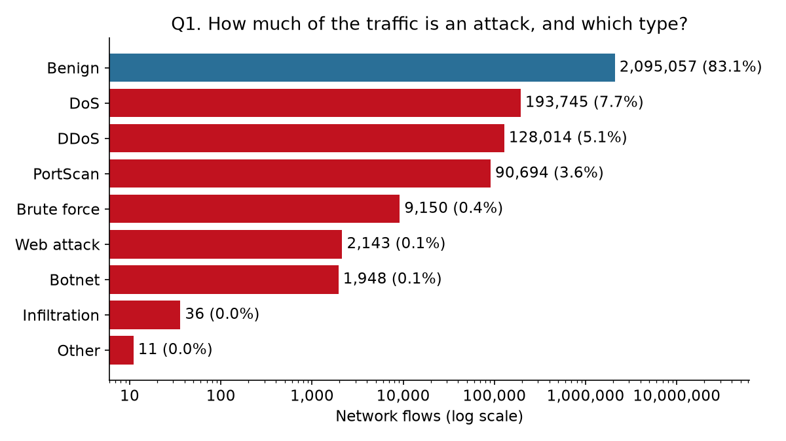
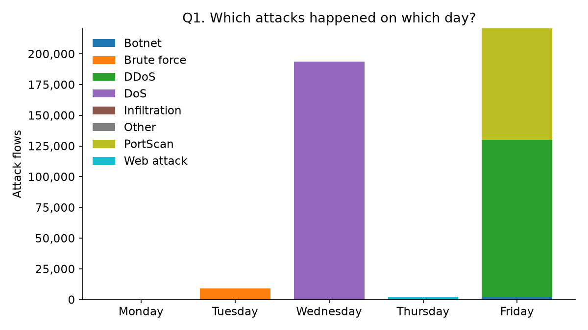
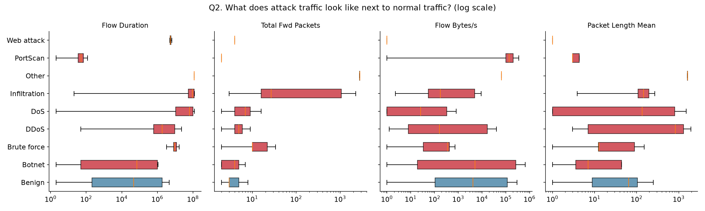
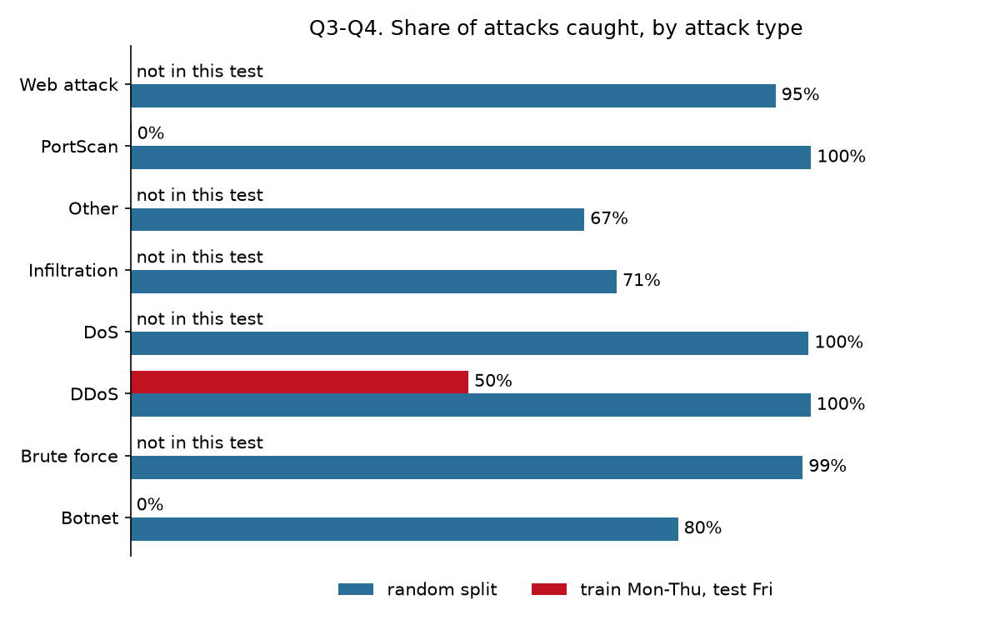

# Can a Model Catch a Cyberattack It Has Never Seen Before?

> [!WARNING]
> **For learning only.** This is a personal study and portfolio project. It is not used commercially and is not intended to harm any person or organisation. It analyses a public research dataset of recorded lab traffic and contains no attack tools. Do not use anything here against a system or network without permission. The datasets belong to their original creators under their own licences.
>
> **เพื่อการศึกษาเท่านั้น** โปรเจกต์นี้จัดทำเพื่อการศึกษาและเป็นผลงานส่วนตัว ไม่ได้ใช้ในเชิงพาณิชย์ และไม่มีเจตนาทำให้บุคคลหรือองค์กรใดเสียหาย โปรเจกต์นี้วิเคราะห์ชุดข้อมูลวิจัยสาธารณะที่บันทึกจากห้องทดลอง และไม่มีเครื่องมือสำหรับโจมตี ห้ามนำส่วนใดไปใช้กับระบบหรือเครือข่ายที่ไม่ได้รับอนุญาต ชุดข้อมูลเป็นของผู้จัดทำต้นทางและอยู่ภายใต้สัญญาอนุญาตของต้นทาง

Data collection, cleaning and analysis of labelled network traffic (CIC-IDS2017), in Python.

**Status:** run on the full dataset (2,830,743 flows; 2,520,798 after cleaning). The traffic comes from a 2017 lab testbed, so the answers describe that testbed, not a live network.

## Dashboard
Interactive dashboard with a plain-language explanation of every chart and a glossary: [`docs/index.html`](docs/index.html).

To publish it with GitHub Pages: repository Settings > Pages > Source "Deploy from a branch" > Branch `main`, folder `/docs`. It is then served at `https://<username>.github.io/<repository>/`. Replace this paragraph with that link once it is live.

## Questions
| # | Question | Answered by | Chart |
|---|---|---|---|
| Q1 | How much of the traffic is an attack, and which attack type is most common? | `02_eda.py` | `01_attack_share.png`, `02_attacks_by_day.png` |
| Q2 | What does attack traffic look like next to normal traffic? | `02_eda.py` | `03_attack_vs_normal.png` |
| Q3 | Can a model tell attacks from normal traffic? | `03_model.py` | `04_attacks_caught.png` |
| Q4 | Can it catch attack types it has never seen before? | `03_model.py` | `04_attacks_caught.png` |

Q3 tests the model on a random 30% of all five days. Q4 trains it on Monday to Thursday and tests it on Friday, whose attack types (botnet, port scan, DDoS) do not occur earlier in the week.

## Answers
**Q1. About one flow in six is an attack, mostly flooding and scanning.**
83.1% of flows are benign and 16.9% are attacks. DoS (7.7%), DDoS (5.1%) and port scans (3.6%) make up almost all of them. Brute force, web attacks and botnet traffic are each under 0.5%. The share is set by the testbed's attack schedule and is much higher than on a real network.




**Q2. Different attacks look nothing alike.**
Port scans are very short flows of one or two packets. DoS and brute-force flows last far longer than typical normal traffic. Botnet traffic overlaps heavily with normal traffic on all four features shown.



**Q3. Yes, when it has seen examples of every attack type.**
With a random 70/30 split the model catches 99.7% of attacks, and 99.4% of its alerts are real attacks. Botnet is the weakest at 80%.

**Q4. Mostly no.**
Trained on Monday to Thursday and tested on Friday, the same model catches 28.9% of attacks: 50% of DDoS, 0.1% of port scans and 0% of botnet flows. When it does raise an alert it is still right 99.6% of the time; it simply stays silent on what it has not seen. DDoS is partly caught, plausibly because the model saw single-source DoS attacks on Wednesday.



The headline: a 99.7% detection score from a random split says little about attacks the model was not trained on.

## Where things are
| Item | Location |
|---|---|
| Objective, data source, cleaning rules, methodology, limitations | `docs/METHODOLOGY.md` |
| Source links and licences | `data/reference/sources.csv` |
| Raw data (not committed, download with the script) | `data/raw/` |
| Cleaned data, EDA sample and cleaning log | `data/clean/` |
| Dashboard (single file, built by `04_dashboard.py`) | `docs/index.html` |
| Charts | `output/png/` |
| Result tables | `output/tables/` |
| Scripts | `scripts/` |

## Re-run
From this folder, with Python 3.11+:

```bash
pip install -r requirements.txt
```

```bash
py scripts/00_download.py
```

```bash
py scripts/01_preprocess.py
```

```bash
py scripts/02_eda.py
```

```bash
py scripts/03_model.py
```

```bash
py scripts/04_dashboard.py
```
